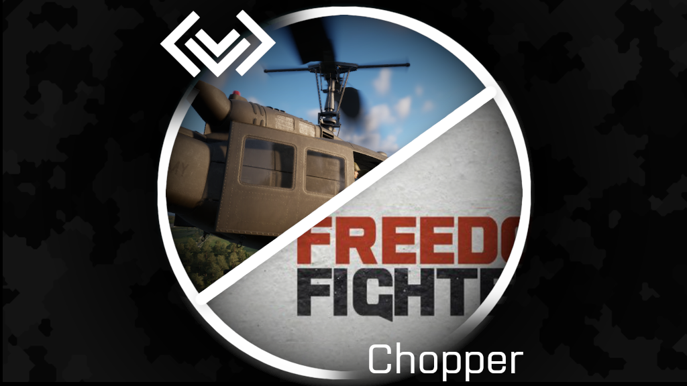

# DarcChopperCompatFF


Compatibility mod for Freedom Fighters that integrates DarcChoppers to game play. DarcMissions and DarcMissionsCompatFF is thoroughly designed to work on any map without specific configs.

* [Version history](./docs/VERSION.md)

## Functionality
* Choppers join battle with a random chance.

When a battle starts, chance to spawn one or more helicopters is checked. By default the spawn chance ``spawnChance`` is 30%. Campaign progress percentage is added to the value and this is the total chance for spawning. 
  Example: With a 20% progression in the campaing, the total default chance is 50%.

If a request to spawn is made, a delay of ``spawnDelay`` (min/max) defined minutes is set for each helicopter. Eventually the helicopter will arrive and do a 'search and destroy' activity around the area. This action will happen for ``attackTime`` (min/max) defined minutes. Once the time is over, the helicopter will behave depending on the ``battleEndType``.

See also: [Search and destroy](https://github.com/mokdevel/DarcMods/blob/main/DarcChopper/docs/P_WP_COMMANDS.md#wp_search_destroy)

## Installation
Just activate the mod (and dependencies) and you're good to go.

## Configuration
Configuration is done in .json files.

# Configuration files
The configuration files will be under your ```profile\DarcMods\*```. Depending on the usage the profile is in your ArmaReforger, ArmaReforgerWorkbench or in your server profile directory. For example ```C:\Users\username\Documents\My Games\ArmaReforger\profile\DarcMods```.

## Parameters
Example: [dc_compatFFConfigChopper.json](https://github.com/mokdevel/DarcMods/blob/main/DarcChopperCompatFF/ExampleConfigs/dc_compatFFConfigChopper.json)

### SDRC_ChopperCompatFFConfig
```
int version : Version id of the file
string author : Author of the file
string comment : Generic comment. Not used in game.
array<string> factions : Factions to use for choppers. "FF" uses Freedom Fighters default.
float spawnChance : Chance percentage that is added on top of campaign progress. Total values of 1.0 means 100% chance.
array<int> spawnDistance : (min, max) Distance to spawn the attacking chopper.
array<int> spawnDelay : (minutes) (min, max) Delay before spawning the attacking chopper.
array<int> attackTime : (minutes) (min, max) Time to attack an area.
array<ref int> attackList : The list of attack indexes.
array<ref SDRC_ChopperCompatFF> attacks : List of attacks
```

### SDRC_ChopperCompatFF
For more details, see related documentation
  * [Flight settings](https://github.com/mokdevel/DarcMods/blob/main/DarcChopper/docs/P_HELICOPTER_FLY.md#flight-settings)
  * ``heliList`` values, see [Vehicle lists](https://github.com/mokdevel/DarcMods/blob/main/DarcMissions/docs/P_LISTS.md#vehicle-lists)
  * ``enemySearchType`` values, see [enemyType](https://github.com/mokdevel/DarcMods/blob/main/DarcChopper/docs/P_HELICOPTER_FLY.md#ai-settings)
```
string comment : Generic comment. Not used in game.
array<int> chopperCount : (min, max) Count of choppers to spawn.
array<string> heliList : List of helicopters to spawn. You can use available vehicle list names or a prefab name.
  Example : 
	{
	"VEHICLE_CHOPPER_ARMED ", "VEHICLE_CHOPPER_ARMED "
	"{5BBDA2DACF9CDCA4}Prefabs/Vehicles/Helicopters/Mi8MT/Mi8MT_unarmed_transport_Patrol.et",
	}
array<int> flyHeight : (min, max) Helicopter fly height.
array<int> speed : (min, max) Helicopter speed. 
array<float> flyDistance : (min, max) Distance for finding new positions
SDRC_EHeliWaypointGenerationType wpType;
SDRC_EHeliEnemySearchType enemySearchType : Type enemy to search for. See Enemy Search Type from DarcChopper documentation.  
SDRC_EBattleEndType battleEndType;
  0 = LEAVE : After the battle, helicopter will fly away and eventually despawn.
  1 = STAY : After the battle, helicopter stay in the area. If no enemies are anymore in the area, it will fly away and eventually despawn.
  2 = LAND : After the battle, helicopter will try to land in a safe spot and the crew will jump out. 
SDRC_ChopperConfigAi ai : AI settings. 
```

### SDRC_ChopperConfigAi
For more details, on AI functionality, read [AI section](https://github.com/mokdevel/DarcMods/tree/main/DarcChopper#ai-functionality)
```
array<int> count : (min, max) Amount of AI groups of characters to spawn.
array<string> types : The prefab names of AI groups or characters. The AI is randomly picked from this list.
  Example : 
	{
	"{A62FA97C4EC64F14}Prefabs/Characters/Factions/OPFOR/USSR_Army/Character_USSR_HeliPilot.et",
	"G_LIGHT", "C_PILOT"
	}
int skill : Skill for AI (0-100). See SCR_AICombatComponent and EaiSkill.
  0 = NONE
  10 = NOOB
  20 = ROOKIE
  50 = REGULAR
  70 = VETERAN
  80 = EXPERT
  100 = CYLON
float perception : How quickly AI reacts to danger. See SCR_AICombatComponent for details on perception factors.
```